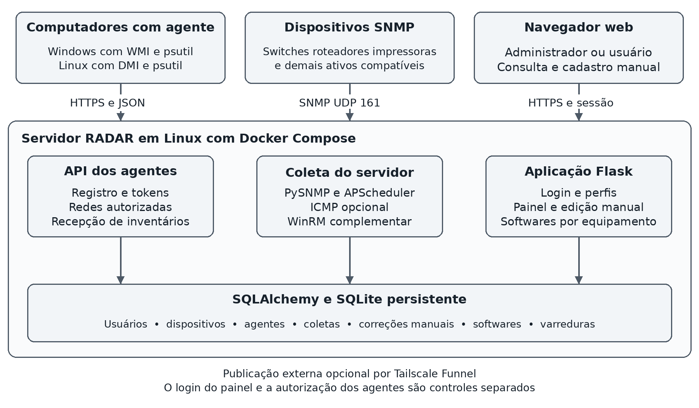
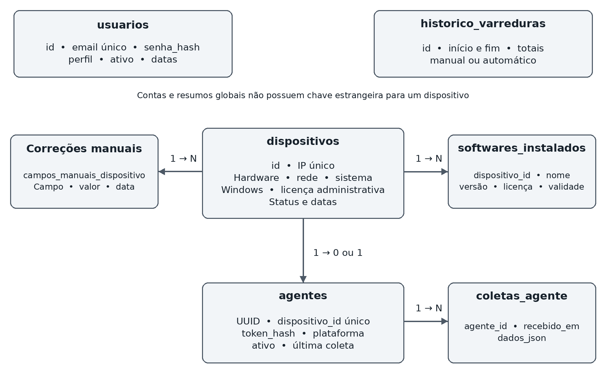

# Documentação técnica e operacional do RADAR

Estado do projeto em 27 de outubro de 2026

R.A.D.A.R. significa Rastreamento Automático de Ativos de Rede. O projeto é uma aplicação de inventário de TI desenvolvida em Python, com painel web, banco SQLite, coleta por agente próprio e consulta SNMP complementar. O ambiente piloto é a CH3 Construtora. A FATEC Osasco permanece como contexto acadêmico do trabalho, e não como identificação da empresa inventariada.

Este documento reúne o funcionamento atual, a estrutura técnica, os procedimentos de instalação e operação, as evidências disponíveis e as limitações que precisam ser consideradas na redação do TCC. A conclusão técnica é que o RADAR já permite coletar e consultar inventário de computadores com agente e complementar seus cadastros manualmente. A cobertura completa da rede, a gestão integral de licenças e a operação definitiva em produção ainda dependem de validação e evolução.

Referência de código: commit `9fe31a4`, acrescido das alterações locais de responsividade, proteção da pasta de banco no Git e ajustes de mensagens do agente presentes nesta data. As versões publicadas em cada servidor precisam ser conferidas separadamente. Os relatos de funcionamento apresentados ao longo do piloto são evidências operacionais; não substituem um relatório formal de testes com amostra e critérios de aceite.

## 1 Finalidade e objetivos

O RADAR centraliza informações técnicas de ativos para apoiar o trabalho da equipe de TI. Em vez de consultar cada computador repetidamente, a equipe instala um agente que coleta os dados locais e os envia ao servidor. O painel permite visualizar o inventário, localizar equipamentos, verificar sua comunicação recente, complementar informações e registrar softwares manualmente.

O objetivo geral é apoiar a gestão do inventário por meio de coleta automatizada e manutenção administrativa dos dados. Os objetivos específicos são identificar equipamentos com um mecanismo de coleta disponível, consolidar atributos de hardware e sistema, manter o último inventário conhecido quando a comunicação termina, permitir correções manuais e disponibilizar consulta com controle de acesso.

A automação começa depois da preparação da infraestrutura e da instalação ou habilitação dos mecanismos de coleta. Instalar o agente, configurar permissões de rede, conferir informações ausentes e registrar programas manualmente continuam sendo atividades da equipe. Portanto, o projeto não deve ser apresentado como inventário totalmente automático de qualquer dispositivo conectado.

## 2 Evolução da solução

O projeto começou como um protótipo com dispositivos simulados em contêineres e dados SNMP preparados. Essa etapa permitiu construir o painel e demonstrar a circulação de dados, mas não comprovava que os equipamentos reais forneceriam todos os atributos simulados.

Em uma validação doméstica, o SNMP de um computador Windows respondeu com dados de sistema, memória, volumes e rede. Modelo e número de série não estavam disponíveis pela ENTITY-MIB consultada. Uma consulta complementar por WMI remoto, transportada pelo WinRM, retornou dados adicionais. Essa prova está registrada em `docs/validacao-laboratorio.md`, com data de 07/10/2026.

Para o piloto empresarial, a coleta dos computadores passou a ser realizada pelo agente RADAR. No Windows, ele consulta WMI localmente por COM, sem precisar habilitar WinRM remoto em cada estação. O SNMP permanece no código como mecanismo para equipamentos que o disponibilizam. A manutenção manual foi ampliada, incluindo softwares como AutoCAD e Archicad.

O Compose atual inicia somente o servidor da aplicação. Os arquivos em `snmp-data/` e o código histórico de preenchimento inicial não participam da execução normal. A presença desses arquivos no repositório não significa que os resultados do piloto sejam simulados.

## 3 Escopo atual e recursos planejados

| Recurso | Situação atual | Limite principal |
| --- | --- | --- |
| Agente Windows | Implementado e com funcionamento relatado no piloto | Exige instalação local e comunicação com o servidor |
| Agente Linux | Coletor e instalador systemd implementados | Implantação e cobertura precisam de validação específica |
| macOS | Fora do piloto | O coletor rejeita sistemas não suportados |
| SNMP | Coletor implementado | Os dados dependem das MIBs e credenciais disponíveis |
| Perfis SNMP v1 v2c v3 | Disponíveis na API Python do coletor | A rotina web usa somente a community v2c configurada |
| Descoberta ICMP | Opcional e desligada por padrão | Ping não produz inventário detalhado |
| Login e perfis | Implementados | Contas locais; sem integração com AD |
| Cadastro de usuários pela web | Implementado para administradores | Sem edição ou desativação de contas pela interface |
| Edição manual de equipamentos | Implementada | IP, status e horário de coleta continuam automáticos |
| Softwares instalados | Cadastro manual com inclusão, edição e exclusão | Sem descoberta automática de programas |
| Ativação do Windows | Coleta implementada | Não comprova titularidade comercial da licença |
| Dashboard e histórico | Implementados | Sem paginação no servidor e sem retenção automática |
| CSV e Excel | Rotas e geração implementadas | Pendências concretas descritas na seção 20 |
| Interface para celular | Ajustes de CSS implementados nesta revisão | Validação em aparelhos reais ainda pendente |
| Acesso externo | Configurado no ambiente por Tailscale Funnel | Serviço de infraestrutura externo ao código RADAR |
| Manutenção e descarte de ativos | Requisitos registrados para evolução | Sem módulo dedicado implementado |

Não existe limite de dez equipamentos no cadastro. A estimativa inicial do piloto não constitui limite funcional nem evidência de capacidade. O scanner possui um limite técnico padrão de 4096 endereços por chamada, e a capacidade real deve ser medida antes de ampliar a implantação.

## 4 Ambiente piloto e organização da rede

| Elemento | Configuração informada | Uso no projeto |
| --- | --- | --- |
| Empresa piloto | CH3 Construtora | Ambiente real de aplicação |
| Rede principal do sétimo andar | 192.168.1.0/24 | Faixa inicial de varredura |
| Gateway do sétimo andar | 192.168.1.1 | Roteamento local |
| Servidor RADAR | 192.168.1.35 reservado | Endereço utilizado pelos agentes |
| Rede do nono andar | 192.168.0.0/24 | Recepção de agentes quando autorizada |
| Enlace entre andares | Interface 10.0.0.1 com máscara /30 | Interligação; não representa a rede das estações |

A existência de uma VLAN de enlace não torna automaticamente todas as redes elegíveis para inventário. A faixa que o scanner percorre é determinada por `SCAN_NETWORK`. As faixas que podem enviar inventários de agentes são definidas por `RADAR_AGENT_ALLOWED_NETWORKS`. As duas configurações têm funções diferentes.

Etiquetas como “7º andar” e “9º andar” são calculadas a partir do IPv4 informado pelo agente ou consultado pelo scanner, conforme `RADAR_NETWORK_LABELS`. Essa etiqueta representa uma associação configurada de rede, e não uma prova de localização física. Um administrador também pode manter uma etiqueta manual sobre o dado coletado.

O parque piloto é majoritariamente Windows. A lista DHCP é uma fonte auxiliar de comparação; o RADAR não importa essa lista automaticamente nem a utiliza como confirmação de inventário completo. Não há integração operacional implementada com ESET PROTECT, Active Directory, GPO ou e-mail corporativo.

## 5 Arquitetura e fluxo de dados



Figura 1. Arquitetura atual da aplicação e mecanismos de coleta. Fonte: elaboração própria com base no código do projeto, 2026.

A solução possui três caminhos de entrada de informações. O agente coleta dados localmente e envia JSON por HTTPS para a API. O servidor consulta equipamentos SNMP pela porta UDP 161. O administrador complementa atributos e softwares por formulários no painel. Esses caminhos convergem no banco SQLite, acessado pela camada SQLAlchemy.

O backend Flask entrega páginas HTML e rotas JSON. O navegador usa JavaScript para consultar dados, construir tabelas e desenhar gráficos. A aplicação pode ser executada diretamente em Python; no piloto, a implantação utiliza Docker Compose em um servidor Linux. Docker empacota o servidor e suas dependências, enquanto o banco fica em uma pasta persistente do host.

O APScheduler inicia no processo executado por `python backend/app.py` e agenda as varreduras. A coleta dos agentes possui um ciclo próprio em cada computador. Os dois agendamentos são independentes: receber um agente não exige aguardar a próxima varredura SNMP.

O Tailscale Funnel é um componente de publicação externo à aplicação. Ele encaminha o acesso web ao servidor local e mantém a tela de login do RADAR. Acesso remoto ao painel e autorização de coleta dos agentes continuam sendo controles separados.

## 6 Tecnologias e organização do código

| Componente | Tecnologia ou versão declarada | Responsabilidade |
| --- | --- | --- |
| Servidor no Docker | Python 3.11 slim | Ambiente de execução |
| Aplicação web | Flask 3.0.3 | Rotas, páginas e sessões |
| Persistência | Flask SQLAlchemy 3.1.1 e SQLite | Modelos e armazenamento |
| Agendamento | APScheduler 3.10.4 | Varreduras periódicas |
| Consulta SNMP | PySNMP 7.1.30 | GET e caminhada de OIDs |
| Consulta WinRM complementar | PyWinRM 0.5.0 | Prova remota para Windows |
| Dados locais e rede | psutil 7.2.2 | Interfaces, memória, volumes e uptime |
| Comunicação do agente | requests 2.34.2 | HTTPS e JSON |
| WMI local Windows | pywin32 312 | Acesso COM ao sistema |
| Arquivos tabulares | pandas 2.2.2 e openpyxl 3.1.2 | Exportação CSV e XLSX |
| Interface | Bootstrap 5.3.3 e Bootstrap Icons 1.11.3 | Layout e componentes |
| Tabelas e gráficos | DataTables 1.13.7 e Chart.js 4.4.3 | Busca, paginação visual e gráficos |

As versões acima são as declaradas nos arquivos do projeto, e não uma conferência do pacote efetivamente instalado em cada estação. `reportlab`, `pytz`, ferramentas SNMP e `nmap` também constam das dependências ou da imagem. Não há rota de relatório PDF implementada, e a descoberta ICMP atual executa `ping`, não Nmap.

```text
radar/
  agent/client.py                  registro e envio do agente
  collector/host_inventory.py      coleta local Windows e Linux
  collector/snmp_scanner.py        consulta SNMP
  collector/network_discovery.py   descoberta opcional por ping
  collector/wmi_collector.py       complemento por WinRM
  backend/app.py                  aplicação e agendador
  backend/models.py               modelos do banco
  backend/auth.py                 sessão e autorização
  backend/create_user.py          criação ou recuperação de conta
  backend/inventory_query.py      seleção de ativos inventariados
  backend/network_labels.py       etiquetas por sub-rede
  backend/routes/                 páginas e API
  backend/templates/              login painel e usuários
  backend/static/                 JavaScript e CSS
  scripts/                        instalação e atualização do agente
  database/                       banco e cópias locais fora do Git
  docs/                           documentação
  Dockerfile e docker-compose.yml implantação do servidor
```

Os arquivos estáticos de Bootstrap, ícones, DataTables, Chart.js e tradução são carregados de CDNs. O funcionamento da interface sem acesso à internet não está integralmente garantido enquanto esses recursos não forem hospedados localmente.

## 7 Coleta local nos computadores

### 7.1 Funcionamento no Windows

O agente acessa o namespace WMI `root\cimv2` na própria máquina por `WbemScripting.SWbemLocator`. A comunicação usa COM através do pywin32. WMI fornece uma representação estruturada de informações do Windows [1]. O agente não abre uma sessão WinRM no servidor e não depende de uma porta de gerenciamento aberta na estação.

| Informação | Origem no Windows | Interpretação |
| --- | --- | --- |
| Fabricante e modelo | Win32_ComputerSystem | Valores disponibilizados pelo fabricante |
| Número de série | Win32_BIOS | Identificador reportado pelo firmware |
| Sistema e edição | Win32_OperatingSystem.Caption | Nome comercial e edição |
| Build e tipo de sistema | Win32_OperatingSystem | Identificação complementar e distinção de servidor |
| Processador | Win32_Processor.Name | Nome informado pelo sistema |
| Processadores lógicos | Win32_Processor.NumberOfLogicalProcessors | Contagem lógica, não número de CPUs físicas |
| Memória | Win32_ComputerSystem.TotalPhysicalMemory | Total reportado ao sistema, em GiB |
| Armazenamento | Win32_LogicalDisk com DriveType igual a 3 | Capacidade dos volumes locais fixos |
| Interfaces | Win32_NetworkAdapterConfiguration com IPEnabled | Adaptadores com IP habilitado |
| IP e MAC selecionados | psutil | Uma interface ativa escolhida pelo coletor |
| Uptime | psutil.boot_time | Tempo desde a inicialização do sistema |
| Ativação e avaliação | SoftwareLicensingProduct | Estado do Windows e data de avaliação, quando informada |

O agente usa o build para corrigir a família do Windows quando necessário. A edição do Windows é obtida do sistema; não existe consulta automática ao calendário de suporte da Microsoft. Exibir Pro, Enterprise ou Home não significa que o produto esteja dentro do período de suporte.

Memória e armazenamento são expressos em GiB, usando divisão por 1024 elevado a 3. O valor de memória reportado pode diferir da capacidade comercial anunciada por causa da memória reservada. Armazenamento representa a capacidade total de volumes como C: e D:, e não espaço livre, integridade de disco ou uma contagem de discos físicos.

### 7.2 Escolha da interface de rede

O coletor descarta interfaces inativas, loopback, IPv4 de autoconfiguração e nomes associados a interfaces virtuais, Docker, Tailscale, VMware, VirtualBox e Hyper V. Entre as candidatas, utiliza prioridade por padrão do nome e ordenação. Essa escolha é uma heurística: não consulta a rota efetiva até o servidor nem transmite todos os IPs ativos.

Em equipamentos com Wi-Fi e Ethernet simultâneos ou VPNs, é necessário conferir se o IP e o MAC selecionados correspondem à conexão desejada. A filtragem ajuda a evitar associação com uma rede virtual, mas não identifica por si só a rede física da empresa.

### 7.3 Funcionamento no Linux

O coletor Linux consulta a identificação da distribuição, os arquivos DMI em `/sys/class/dmi/id`, dados de CPU em `/proc/cpuinfo` e recursos fornecidos pelo psutil. Número de série pode exigir privilégio elevado ou não estar disponível. Os volumes são descritos pelos pontos de montagem; eles não representam necessariamente discos físicos distintos.

A implementação Linux existe no código, porém o piloto empresarial descrito foi concentrado em Windows. Não se deve apresentar compatibilidade plenamente validada em todas as distribuições apenas por existir um instalador.

## 8 Coleta SNMP e descoberta auxiliar

O servidor consulta uma sub-rede IPv4 por chamada. O coletor usa concorrência assíncrona com limite padrão de 32 consultas e tempo de espera de 1,5 segundo por requisição, sem repetição automática nesse transporte. Consultas complementares de tabelas aumentam a duração total. Por isso, 1,5 segundo não é um limite para a duração de toda a varredura.

| Grupo ou objeto | OID utilizado | Finalidade |
| --- | --- | --- |
| sysDescr | 1.3.6.1.2.1.1.1.0 | Descrição do sistema |
| sysObjectID | 1.3.6.1.2.1.1.2.0 | Identificador do fornecedor ou produto |
| sysUpTime | 1.3.6.1.2.1.1.3.0 | Tempo do subsistema de gerenciamento |
| sysContact | 1.3.6.1.2.1.1.4.0 | Contato configurado no equipamento |
| sysName e sysLocation | 1.3.6.1.2.1.1.5.0 e 1.6.0 | Nome e localização |
| ifNumber | 1.3.6.1.2.1.2.1.0 | Quantidade de interfaces reportadas |
| hrMemorySize | 1.3.6.1.2.1.25.2.2.0 | Memória em KiB |
| hrStorageTable | 1.3.6.1.2.1.25.2.3.1 | Unidades e capacidade de armazenamento |
| hrProcessorLoad | 1.3.6.1.2.1.25.3.3.1.2 | Contagem de entradas de CPU disponíveis |
| ENTITY MIB | 1.3.6.1.2.1.47.1.1.1.1 | Classe, modelo e serial do chassi |
| IP MIB e ifPhysAddress | 1.3.6.1.2.1.4 e 1.3.6.1.2.1.2.2.1.6 | Associação do IPv4 à interface e ao MAC |

A HOST RESOURCES MIB especifica objetos de recursos do host [3]. A ENTITY MIB descreve componentes físicos e suas relações [4]. O suporte a essas MIBs depende do equipamento. Um serviço SNMP ativo não garante que modelo, CPU comercial, armazenamento ou licença sejam fornecidos.

O código consulta modelo e serial de entradas identificadas como chassi. A rotina de armazenamento SNMP atual reconhece principalmente volumes Windows com letra de unidade. A identificação de processador por SNMP usa a descrição e a contagem de entradas disponíveis; ela não equivale ao nome comercial coletado pelo WMI local. A classificação de tipo do dispositivo é heurística e pode exigir correção manual.

O valor sysUpTime corresponde ao tempo do componente de gerenciamento, que pode reiniciar separadamente do sistema operacional. Da mesma forma, ifNumber não deve ser interpretado automaticamente como número de portas físicas de um switch.

O coletor Python aceita perfis v1, v2c e v3. Entretanto, a rotina que a aplicação agenda chama o coletor com uma community e utiliza v2c. Não há formulário de perfis SNMPv3 nem configuração de múltiplas credenciais integrada ao fluxo web atual. A segurança do SNMPv3 é parte da arquitetura padronizada do protocolo [5], mas sua disponibilidade no coletor não comprova implantação no piloto.

A descoberta por ICMP é opcional. Quando ativada, um host que responde apenas a ping pode ser armazenado como “Host sem coleta”. A consulta operacional filtra os hosts sem inventário útil para reduzir ruído. Um host silencioso, sem agente e sem resposta SNMP, pode continuar desconhecido mesmo que esteja conectado à rede.

## 9 Registro e comunicação dos agentes

Cada instalação recebe uma identidade UUID e um token próprio. O token compartilhado de registro autoriza somente a etapa inicial de cadastro. Ele não substitui os tokens individuais usados nas coletas seguintes.

1. O administrador configura o token de registro no ambiente do servidor e define as redes autorizadas.
2. O instalador executa a coleta local e envia `agent_id`, `plataforma` e `dados` para `/api/agentes/registrar`.
3. O servidor verifica a origem da conexão, a credencial de registro, o formato dos dados e o IP informado.
4. O servidor vincula a identidade do agente a um dispositivo, gera um token individual e guarda apenas seu hash SHA 256 no banco.
5. O computador salva a URL, o UUID, o token individual e o caminho da CA no arquivo local de estado.
6. Nas coletas periódicas, o agente envia o token individual no cabeçalho Authorization com esquema Bearer.
7. A cada inventário aceito, o servidor atualiza o cadastro, a última coleta e o registro JSON da coleta.

Exemplo de estrutura de envio, com valores ilustrativos e sem credenciais reais:

```json
{
  "agent_id": "11111111-1111-4111-8111-111111111111",
  "plataforma": "win32",
  "dados": {
    "ip": "192.168.1.50",
    "hostname": "PC-EXEMPLO",
    "modelo": "Modelo informado pelo fabricante",
    "sistema_op": "Windows 11 Pro (build informado)",
    "interfaces": 1
  }
}
```

O IP de origem da requisição e o IP informado no inventário precisam pertencer às redes autorizadas. O servidor não confia apenas no IP de origem porque ele pode representar um NAT. Essa verificação utiliza endereços IP, e não uma identidade criptográfica da rede física; sub-redes sobrepostas e roteamento precisam ser avaliados pela equipe.

Coletas de agentes recebem timeout HTTP de 20 segundos no cliente. No modo periódico, uma falha é registrada e o agente tenta novamente após o intervalo configurado. Não há fila persistente de inventários para reenviar todas as amostras perdidas durante uma interrupção.

## 10 Estado online intervalos e compatibilidade

Para um computador com agente, online significa que o servidor recebeu uma coleta válida recentemente e que o registro está habilitado. Se a coleta deixa de chegar, o equipamento passa a offline após a janela configurada. O indicador não fornece detecção instantânea de desconexão.

| Temporizador | Valor atual de referência | Onde configurar |
| --- | --- | --- |
| Coleta do agente Windows | 60 segundos | IntervalSeconds no instalador |
| Coleta do agente Linux | 900 segundos por padrão do script | Opção interval; recomenda-se ajustar no piloto |
| Agente pela linha de comando | Uma coleta quando interval é zero | Opção interval aceita ciclos de pelo menos 60 segundos |
| Varredura do servidor | 300 segundos no exemplo e no Compose | SCAN_INTERVAL |
| Janela para marcar offline | 900 segundos | AGENT_OFFLINE_AFTER_SECONDS |
| Atualização de indicadores no navegador | 30 segundos | JavaScript do painel |

Sem `SCAN_INTERVAL`, a execução nativa tem fallback de 60 segundos no código do agendador. Por isso, o arquivo de configuração deve conter explicitamente o intervalo desejado. Recomenda-se que a janela offline seja maior que o intervalo do agente, com margem para duração da coleta e oscilações de rede. O padrão Linux de 900 segundos coincide com a janela padrão e pode produzir alternância de status.

Os endpoints de consulta atualizam a expiração dos agentes. A varredura também considera a idade da última coleta. Uma recusa por rede pode marcar o ativo offline, mas uma varredura seguinte pode voltar a considerar a coleta válida anterior enquanto ela ainda estiver dentro da janela. Esse comportamento precisa ser levado em conta ao medir o tempo de reconhecimento de saída da rede.

A atualização a cada 30 segundos no navegador recarrega os indicadores e gráficos. A tabela de dispositivos é recarregada ao entrar na seção, mudar filtros ou salvar uma edição; ela não recebe atualizações contínuas por WebSocket.

O protocolo atual não possui um número formal de versão de agente. Campos opcionais ausentes geralmente preservam valores textuais já existentes, e a edição do Windows pode ser derivada do sistema operacional. A contagem de interfaces, porém, pode voltar a zero quando omitida. Não há garantia de compatibilidade irrestrita com qualquer cliente antigo: identidade, token, estrutura obrigatória e regras de rede continuam necessários. Erros locais, como módulos de versões diferentes, não podem ser corrigidos apenas pelo servidor.

## 11 Uso do painel e manutenção manual

O login utiliza contas locais salvas em `usuarios`. O perfil `admin` pode iniciar varreduras, editar dados, manter softwares e cadastrar contas. O perfil `usuario` pode consultar o painel, detalhes e histórico, além de acessar as rotas de exportação. A primeira conta deve ser criada pelo utilitário de terminal; depois disso, contas adicionais podem ser cadastradas na página Usuários.

A página Usuários solicita nome, e-mail, perfil, senha inicial e confirmação. A senha precisa ter pelo menos 12 caracteres nesse formulário. Há verificação de e-mail já cadastrado e proteção por token CSRF nessa página. As contas persistem no SQLite. Não existem cadastro público, recuperação de senha por e-mail, edição de perfil ou desativação pela tela atual. O utilitário de terminal também pode redefinir uma conta existente.

O dashboard apresenta totais de ativos inventariados, online e offline, distribuição por tipo e histórico recente. A tela Dispositivos oferece busca, filtros e paginação visual. Ao selecionar um equipamento, o modal consulta seus detalhes atuais, dados de hardware, rede, Windows, contato e softwares cadastrados.

### 11.1 Campos que o administrador pode preencher

| Grupo | Campos editáveis |
| --- | --- |
| Identificação | Hostname, tipo, modelo e número de série |
| Hardware | Processador, memória e armazenamento |
| Sistema | Sistema operacional e descrição |
| Rede | MAC, etiqueta de rede ou andar, interfaces e uptime |
| Administração | Localização e contato |
| Windows | Edição, estado de ativação e expiração informada |
| Licença administrativa existente | Nome da licença e validade cadastrada |

O IP, o estado online ou offline e o horário da última coleta permanecem automáticos. Esses dados representam a comunicação observada pelo sistema. Alterá-los apenas como texto poderia mascarar uma mudança de rede ou de disponibilidade.

As correções de atributos são mantidas na tabela `campos_manuais_dispositivo`, separadas da coleta original. A apresentação JSON do cadastro aplica o valor manual com prioridade; apagar a correção devolve o campo ao valor coletado. Os campos administrativos `licenca_software` e `licenca_expira` são exceções: são gravados diretamente no dispositivo.

Essa prioridade é aplicada à apresentação dos dados. Filtros, agrupamentos por tipo e exportações ainda consultam determinadas colunas originais do modelo. Assim, uma correção manual de tipo pode aparecer no modal sem mudar a distribuição do gráfico. Essa divergência está registrada entre as pendências.

### 11.2 Softwares cadastrados manualmente

No modal, o botão Cadastrar software abre um formulário vinculado ao equipamento. O único campo obrigatório é o nome. Fabricante, versão, tipo de licença, validade e observações são opcionais. Por exemplo, AutoCAD pode ser cadastrado com fabricante Autodesk, versão usada pela empresa e licença por assinatura; os dados devem vir de conferência administrativa.

Cada registro pode ser editado ou excluído por administrador. A exclusão remove apenas o item do inventário e não desinstala o programa do computador. O agente não enumera os programas instalados, não mede uso e não consulta portais de licenciamento dos fabricantes.

### 11.3 Acesso em celular

Os ajustes atuais reduzem a barra lateral para uma navegação horizontal rolável, reorganizam os indicadores em duas colunas e adaptam filtros e modal. Tabelas extensas permanecem disponíveis por rolagem horizontal. O login já possui layout compacto, e a página de usuários usa formulário em colunas que se empilham em telas pequenas. Esses ajustes existem no CSS e ainda precisam de validação visual em aparelhos reais.

## 12 Interpretação das licenças

O RADAR trata três conjuntos de informações que precisam ser apresentados separadamente no TCC: edição e ativação do Windows, campo administrativo de licença do equipamento e registros manuais de softwares instalados.

No Windows, o agente consulta `SoftwareLicensingProduct` e utiliza `LicenseStatus` e `EvaluationEndDate` [2]. O filtro usa a existência de PartialProductKey para selecionar produtos, mas não solicita nem transmite a chave de produto. O estado Ativo significa que o Windows retornou estado licenciado ou ativado. Isso não comprova nota fiscal, contrato, quantidade de licenças ou titularidade.

Expiração do Windows só aparece quando o provedor informa uma data utilizável de avaliação. Licenças permanentes podem não fornecer uma data. Renovação KMS e período de carência não são tratados como vencimento comercial. Não é correto inventar uma data apenas porque a tela possui o campo “Expira em”.

Os campos administrativos de licença permitem um nome e uma data. O cálculo de dias restantes classifica datas passadas como expiradas, até 30 dias como críticas, de 31 a 90 como atenção e acima de 90 como válidas. Sem data, o estado administrativo é “sem licença”; ele não representa uma auditoria jurídica.

Os softwares manuais possuem tipo de licença e validade próprios. Atualmente não alimentam um catálogo central de contratos, não controlam quantidade de assentos e não geram alertas automáticos de vencimento por software. O badge principal do equipamento prioriza o estado de ativação do Windows quando ele existe.

## 13 Modelo de dados e persistência



Figura 2. Relações lógicas entre os principais registros. Fonte: elaboração própria com base em `backend/models.py`, 2026.

O banco SQLite padrão é `database/inventario.db`. No Docker, a pasta do host é montada em `/app/database`. O programa cria as tabelas ausentes ao iniciar. Para algumas colunas recentes do dispositivo, há comandos de alteração de tabela na inicialização. Isso não constitui um sistema completo de migrações com histórico e reversão.

| Tabela | Chave e principais campos | Finalidade |
| --- | --- | --- |
| usuarios | id; nome; email único; senha_hash; perfil; ativo; criado_em | Contas locais e autorização |
| dispositivos | id; ip único; dados de hardware, rede, sistema e licença; datas | Último cadastro conhecido do ativo |
| campos_manuais_dispositivo | id; dispositivo_id; campo; valor; atualizado_em | Correções sobre a coleta; unicidade por ativo e campo |
| softwares_instalados | id; dispositivo_id; nome; fabricante; versão; licença; data; observação | Inventário manual de programas |
| agentes | UUID; dispositivo_id único; token_hash; plataforma; ativo; datas | Identidade de uma instalação de agente |
| coletas_agente | id; agente_id; recebido_em; dados_json | Histórico bruto dos inventários aceitos |
| historico_varreduras | id; início; fim; totais; disparado_por | Resumo das execuções de varredura |

Um dispositivo pode possuir várias correções e vários softwares, mas somente um registro de agente. Um agente possui muitas coletas. O histórico de varreduras guarda totais agregados e não contém uma relação individual com cada alteração do equipamento. Usuários não estão associados a um log de autoria de edições.

### 13.1 Dicionário do cadastro de equipamentos

| Campos | Tipo ou tamanho do modelo | Origem principal |
| --- | --- | --- |
| id | Inteiro, chave primária | Banco |
| ip | Texto 15, obrigatório e único | Agente ou alvo consultado |
| hostname e tipo | Texto 100 e 50 | Coleta ou correção manual |
| modelo | Texto 150 | WMI, DMI, ENTITY MIB ou manual |
| sistema_op | Texto 100 | Coleta ou manual |
| processador | Texto 100 | Coleta ou manual |
| armazenamento e memoria | Texto 50 cada | Coleta ou manual |
| mac_address e serial_number | Texto 17 e 50 | Coleta ou manual |
| descricao | Texto longo | Coleta ou manual |
| localizacao e contato | Texto 200 cada | SNMP ou manual |
| rede | Texto 100 | Mapeamento de CIDR ou manual |
| interfaces | Inteiro | Coleta; correção convertida na apresentação |
| uptime | Texto 50 | Coleta ou manual |
| status | Texto 10 | Regra de disponibilidade |
| licenca_software e licenca_expira | Texto 100 e data | Cadastro administrativo |
| edicao_windows | Texto 100 | Agente ou manual |
| status_ativacao_windows | Texto 60 | Agente ou manual |
| licenca_windows_expira | Data | Agente ou manual |
| ultima_vez e criado_em | Data e hora | Aplicação |

Limites de tamanho também são verificados na API do agente. Nomes longos de CPU com contagem de processadores e listas extensas de volumes podem ultrapassar esses limites e provocar recusa HTTP 400. É necessário tratar esse cenário antes de considerar cobertura ampla de hardware.

### 13.2 Dicionário de softwares

| Campo | Tipo ou limite | Obrigatoriedade |
| --- | --- | --- |
| id e dispositivo_id | Inteiros; vínculo com equipamento | Automáticos |
| nome | Texto 150 | Obrigatório |
| fabricante | Texto 120 | Opcional |
| versao | Texto 80 | Opcional |
| tipo_licenca | Texto 80 | Opcional e livre |
| expira_em | Data ISO no JSON | Opcional |
| observacao | Texto; limite de API de 1000 caracteres | Opcional |
| criado_em e atualizado_em | Data e hora | Automáticos |

O IP é único e pode mudar durante a vida de um agente. O vínculo persistente é o UUID do agente associado ao id do dispositivo. Se um IP já estiver associado a outro registro, a API devolve conflito 409; não existe conciliação automática completa de duplicidades por DHCP, serial ou MAC.

## 14 Contrato da API e das páginas

| Método | Caminho | Permissão | Resultado |
| --- | --- | --- | --- |
| GET e POST | /login | Público | Formulário e autenticação |
| POST | /logout | Sessão do navegador | Encerra sessão |
| GET | / | Usuário autenticado | Dashboard |
| GET e POST | /usuarios | Administrador | Lista e criação de contas |
| GET | /api/dispositivos | Usuário autenticado | Lista; filtros tipo e status |
| GET | /api/dispositivos/id | Usuário autenticado | Detalhes e softwares do ativo |
| PUT | /api/dispositivos/id/manual | Administrador | Atualiza campos autorizados |
| POST | /api/dispositivos/id/softwares | Administrador | Cria software; retorna 201 |
| PUT e DELETE | /api/dispositivos/id/softwares/software_id | Administrador | Edita ou remove software |
| GET | /api/stats | Usuário autenticado | Indicadores e distribuição por tipo |
| GET | /api/historico | Usuário autenticado | Histórico de varreduras |
| POST | /api/scan | Administrador | Executa varredura de forma síncrona |
| GET | /api/export/csv | Usuário autenticado | Exportação CSV após correção da pendência |
| GET | /api/export/excel | Usuário autenticado | Exportação XLSX após correção da pendência |
| POST | /api/agentes/registrar | Token inicial e redes autorizadas | Registra identidade e emite token |
| POST | /api/agentes/inventario | Token individual e redes autorizadas | Recebe inventário; retorna 200 |

Nos caminhos acima, `id` e `software_id` são valores inteiros. A API de coleta do agente exige IPv4, UUID válido, plataforma e um objeto `dados`. Datas transmitidas usam AAAA-MM-DD. Campos textuais ausentes não são necessariamente erros; os campos obrigatórios de identidade e rede não podem ser omitidos.

Respostas de falha relevantes são 400 para formato ou limites inválidos, 401 para autenticação inválida, 403 para perfil ou rede sem autorização, 404 para recurso inexistente e 409 para identidade ou IP em conflito. Falhas internas podem resultar em 500. Os endpoints de agentes usam tokens, enquanto as rotas do painel usam sessão de navegador.

Não há endpoint específico de health check, OpenAPI publicado, importação de planilhas, exclusão geral de dispositivo nem controle de versão de API implementados. A existência de botões de exportação na interface não substitui a validação das rotas.

## 15 Configuração do servidor

As configurações ficam em `.env`, que não deve ser versionado. O exemplo público apresenta nomes e valores de referência, sem segredos. Não é necessário copiar o `.env` do servidor para as estações.

| Variável | Valor de referência | Função e observação |
| --- | --- | --- |
| SCAN_NETWORK | 192.168.1.0/24 | Uma sub-rede para o scanner; obrigatória no Compose |
| SCAN_COMMUNITY | Definir localmente | Community SNMP da rotina v2c |
| SCAN_INTERVAL | 300 | Intervalo do agendador em segundos |
| RADAR_SECRET_KEY | Segredo aleatório estável | Assina sessões; manter entre reinicializações |
| RADAR_COOKIE_SECURE | false no exemplo | Usar true com acesso exclusivamente HTTPS |
| DISCOVERY_ICMP_ENABLED | false | Habilita descoberta por ping |
| DISCOVERY_CONCURRENCY | 32 | Concorrência da descoberta ICMP |
| DISCOVERY_PING_TIMEOUT_MS | 800 | Timeout do ping em milissegundos |
| AGENT_OFFLINE_AFTER_SECONDS | 900 | Idade máxima da última coleta |
| RADAR_AGENT_ALLOWED_NETWORKS | Vazio usa SCAN_NETWORK | CIDRs separados por vírgula ou ponto e vírgula |
| RADAR_NETWORK_LABELS | CIDR seguido de dois pontos e etiqueta | Etiquetas separadas por vírgula |
| RADAR_AGENT_ENROLLMENT_TOKEN | Definir localmente | Segredo para o primeiro registro dos agentes |
| RADAR_TLS_CERT_FILE | Caminho PEM | Certificado visível pelo processo servidor |
| RADAR_TLS_KEY_FILE | Caminho PEM | Chave privada correspondente |
| RADAR_CERTS_DIR | ./certs no Compose | Pasta de certificados no host |
| RADAR_PORT | 5000 | Manter mapeamento Docker coerente com a porta interna |
| RADAR_DATABASE_PATH | Caminho padrão do projeto | Alternativa nativa; não repassada pelo Compose atual |
| SCAN_WMI_USERNAME e SCAN_WMI_PASSWORD | Vazias | Habilitam complemento WinRM quando ambas presentes |
| SCAN_WMI_PORT e SCAN_WMI_HTTPS | 5985 e false | Transporte do complemento WinRM |
| TZ | America/Sao_Paulo no Compose | Fuso do processo |

O Compose publica a porta interna 5000. Se `RADAR_PORT` for alterada, o mapeamento e a porta usada pelo processo precisam ser revisados juntos; mudar somente uma variável pode impedir o acesso. O valor 5000 é a referência do piloto.

Exemplo das redes, sem incluir segredos:

```dotenv
SCAN_NETWORK=192.168.1.0/24
SCAN_INTERVAL=300
RADAR_AGENT_ALLOWED_NETWORKS=192.168.1.0/24,192.168.0.0/24
RADAR_NETWORK_LABELS=192.168.1.0/24:7º andar,192.168.0.0/24:9º andar
AGENT_OFFLINE_AFTER_SECONDS=900
DISCOVERY_ICMP_ENABLED=false
```

Autorizar agentes do nono andar não faz o scanner percorrer a rede do nono andar. Para isso seria necessário alterar o alvo de varredura ou implementar múltiplas sub-redes na rotina.

## 16 Instalação e atualização do servidor

### 16.1 Implantação Docker no Linux

Pré-requisitos: Docker e o plugin Compose disponíveis, diretório do código atualizado, conectividade até as redes autorizadas e certificados preparados para HTTPS. A reserva 192.168.1.35 identifica o servidor no piloto; outros ambientes devem usar seus próprios endereços.

```bash
cd /radar
cp .env.example .env
```

Após editar o `.env`, gerar os segredos localmente e configurar certificados, iniciar a aplicação:

```bash
docker compose up -d --build inventario-app
docker compose ps
docker compose logs --tail=100 inventario-app
```

O primeiro administrador é criado no banco persistente. A senha é solicitada no terminal:

```bash
docker compose exec inventario-app python -m backend.create_user \
  --nome "Administrador" --email admin@exemplo.local --perfil admin
```

Esse e-mail é um exemplo. O comando deve ser executado com uma conta definida para o ambiente. Após login, o menu Usuários permite criar contas adicionais sem repetir o procedimento no terminal.

O Dockerfile copia `backend/` e `collector/` para a imagem, mas não monta o código como volume. Uma edição no host exige reconstruir a imagem para aparecer na aplicação. Se a edição ocorreu em outro computador, primeiro é necessário transferir ou obter os arquivos atualizados no servidor.

```bash
docker compose up -d --build --force-recreate inventario-app
```

Commit registra uma revisão no Git. Push envia essa revisão ao remoto. Pull obtém código no servidor. Reconstruir a imagem incorpora os arquivos locais ao contêiner. Nenhuma dessas etapas substitui automaticamente as demais. Não é preciso um commit para executar arquivos já presentes no mesmo host.

### 16.2 Execução nativa

O servidor pode ser iniciado diretamente por Python com as dependências de `requirements.txt`. A versão 3.11 é a referência concreta da imagem do projeto. A aceitação de Python 3.14 no instalador do agente não significa que todas as dependências do servidor tenham sido homologadas nessa versão.

```bash
python3 -m venv .venv
source .venv/bin/activate
python -m pip install -r requirements.txt
python -m backend.create_user --nome "Administrador" \
  --email admin@exemplo.local --perfil admin
python backend/app.py
```

No Windows, a ativação do ambiente usa `.\.venv\Scripts\Activate.ps1`. Descoberta ICMP depende da presença do executável ping. O scanner SNMP usa PySNMP e não exige que um serviço SNMP local seja instalado no servidor RADAR.

### 16.3 HTTPS e publicação externa

Para TLS direto, configurar certificado e chave PEM em caminhos acessíveis ao processo. No Docker, o diretório `certs/` é montado somente para leitura; caminhos usuais são `/app/certs/server.crt` e `/app/certs/server.key`. O certificado deve ser válido para o nome ou endereço realmente utilizado, e a CA precisa ser confiável para o cliente.

O Funnel já foi utilizado no ambiente para disponibilizar o painel por HTTPS sem exigir Tailscale em cada navegador. A documentação oficial descreve esse acesso público [7]. A configuração operacional encaminhou a publicação ao serviço local HTTPS. Ela pertence ao ambiente e não é criada pelo Compose.

O fato de o acesso público usar HTTPS não converte automaticamente a URL local dos agentes em HTTPS nem altera as redes autorizadas da API. Em qualquer configuração com proxy, o tratamento de origem e confiança dos cabeçalhos deve ser revisado antes de ampliar o uso. O servidor embutido Flask continua sendo uma pendência para operação definitiva; a documentação oficial recomenda um servidor WSGI adequado [6].

## 17 Instalação e atualização dos agentes

### 17.1 Pacote necessário no Windows

Não é preciso copiar o banco nem instalar o servidor em cada computador. O instalador precisa da seguinte estrutura de origem:

```text
C:\radar\
  agent\
    __init__.py
    client.py
  collector\
    host_inventory.py
    demais arquivos da pasta collector
  scripts\
    install-agent-windows.ps1
    update-agent-windows.ps1
  agent-requirements.txt
  radar-ca.crt
```

A CA é um certificado público necessário apenas quando a cadeia não for confiável por padrão. A chave privada do servidor, o `.env`, o banco e arquivos com tokens não pertencem a esse pacote.

Instalar Python manualmente antes de executar o script. O instalador não usa mais winget nem baixa o Python. Usar preferencialmente uma instalação para todos os usuários, porque a tarefa será executada por SYSTEM. O Python dentro de um perfil pessoal pode deixar de estar acessível se o perfil for removido ou suas permissões mudarem.

No PowerShell aberto como administrador, executar em uma única linha:

```powershell
powershell.exe -NoProfile -ExecutionPolicy Bypass -File "C:\radar\scripts\install-agent-windows.ps1" -ServerUrl "https://192.168.1.35:5000" -CaBundle "C:\radar\radar-ca.crt" -PythonPath "C:\Program Files\Python314\python.exe"
```

O caminho do Python é ilustrativo e deve apontar para o executável real. O uso de `-File` evita que o Windows tente abrir o `.ps1` no editor. A política Bypass desse comando é aplicada ao processo iniciado, não uma alteração permanente da política da máquina.

O script copia o código para `%ProgramFiles%\RADAR\src`, cria um ambiente virtual, instala `agent-requirements.txt`, pede o token de registro e cria a tarefa `RADAR Agent`. A tarefa inicia no boot e mantém o ciclo de coleta como SYSTEM. Não é um serviço Windows nativo registrado no Service Control Manager.

O estado fica em `%ProgramData%\RADAR\agent.json`, com permissões para SYSTEM e Administradores. O log fica em `%ProgramData%\RADAR\agent.log`, com rotação de aproximadamente 1 MB e três cópias. A senha da conta administrativa usada na instalação não é gravada pelo agente.

### 17.2 Verificação e atualização do agente Windows

```powershell
Get-ScheduledTask -TaskName 'RADAR Agent'
Get-ScheduledTaskInfo -TaskName 'RADAR Agent'
Get-Content "$env:ProgramData\RADAR\agent.log" -Tail 50
Test-NetConnection 192.168.1.35 -Port 5000
```

Uma conexão TCP bem-sucedida confirma acesso à porta. Ela não confirma certificado, token válido ou aceitação do inventário.

Para atualizar, copiar o pacote de código novo para `C:\radar` e executar:

```powershell
& "C:\radar\scripts\update-agent-windows.ps1" -ProjectPath "C:\radar"
```

O atualizador para a tarefa, copia `agent/` e `collector/` e reinicia a execução, preservando identidade e token. Ele não reinstala dependências, não troca a CA nem altera o intervalo. Alterações de dependências exigem um procedimento adicional. Reexecutar o instalador faz novo registro e pode emitir outro token; não é a atualização de rotina recomendada.

Mudar o usuário interativo de administrador para usuário comum não deveria encerrar uma tarefa configurada como SYSTEM. A coleta ainda depende de tarefa ativa, Python acessível, arquivos íntegros e rede disponível.

### 17.3 Instalação Linux e remoção controlada

O instalador Linux usa systemd e precisa de Python com suporte a ambiente virtual. Ele copia o código para `/opt/radar-agent/src`, grava estado em `/var/lib/radar-agent/agent.json` e cria `radar-agent.service` como root.

```bash
sudo bash scripts/install-agent-linux.sh \
  --server-url https://radar.empresa.local \
  --ca-bundle /caminho/empresa-ca.pem --interval 60
sudo systemctl status radar-agent.service
sudo journalctl -u radar-agent.service -n 50
```

O exemplo utiliza nome ilustrativo. O serviço tem reinício após falha e restrições systemd de acesso ao sistema de arquivos. Não existe script específico de atualização Linux no repositório atual.

Antes de remover uma instalação, parar e desregistrar a tarefa ou serviço, preservar o estado caso seja necessário manter a identidade e registrar o motivo da remoção. Apagar `agent.json` perde o token individual. Apagar somente a pasta usada para distribuir o pacote não remove a instalação em Program Files. O projeto ainda não fornece um desinstalador próprio com conciliação no servidor.

## 18 Operação backup e recuperação

O banco contém inventário, usuários, hashes dos tokens individuais e histórico de coletas. Por isso, apagar o banco e criar outro vazio impede que as instalações existentes sejam reconhecidas, mesmo quando o token inicial do `.env` permanece igual. O token de registro não reconstrói os hashes individuais perdidos.

Para uma cópia simples e consistente em ambiente pequeno, parar temporariamente a aplicação, copiar o SQLite para um local protegido e reiniciar. A API de backup do SQLite é alternativa para cópia com o banco em uso [8]. Copiar o arquivo aberto sem coordenação não é o procedimento recomendado.

```bash
docker compose stop inventario-app
cp database/inventario.db /caminho-protegido/inventario-AAAAMMDD-HHMM.db
docker compose start inventario-app
```

O destino do comando é ilustrativo e deve existir. Guardar também uma cópia protegida da configuração e dos certificados necessários à recuperação. Backups devem ficar fora do repositório e, preferencialmente, fora do mesmo disco do servidor. A pasta `database/`, inclusive backups sem extensão convencional, está ignorada pelo Git nesta revisão.

Para restaurar, interromper o servidor, preservar o banco atual como retorno de segurança, colocar a cópia íntegra no caminho esperado e revisar proprietário e permissões antes de iniciar. A cópia deve conter as identidades dos agentes e os hashes correspondentes aos estados locais. Um backup anterior a determinado registro não reconhecerá aquele agente.

Manter `RADAR_SECRET_KEY` estável preserva a capacidade de verificar sessões. Alterá-la invalida sessões de navegador, porém não recria nem substitui os tokens dos agentes. Banco e arquivo local de estado de cada agente são partes diferentes da recuperação.

Logs úteis ficam na saída do contêiner e no arquivo do agente. Não existe rotação automática de histórico no banco, agendamento de backup ou interface de restauração implementados. O crescimento de `coletas_agente` deve ser monitorado durante o piloto.

## 19 Segurança e controle de acesso

O painel usa senha armazenada como hash pelo Werkzeug. A sessão tem duração configurada de oito horas, cookie HttpOnly, SameSite Lax e opção Secure. Se a chave de sessão não for configurada, a aplicação gera uma ao iniciar e as sessões anteriores deixam de ser verificáveis após reinício.

Os agentes usam credencial individual e o servidor guarda seu hash. A conexão deve validar HTTPS e a CA correspondente. HTTP exige opção explícita do cliente para laboratório. Os scripts elevam privilégios localmente para instalar a tarefa ou serviço e proteger o estado; não precisam enviar a senha administrativa ao servidor RADAR.

O token inicial de registro pode ser removido do ambiente depois da etapa de implantação. Isso impede novos registros enquanto os tokens individuais continuam funcionando. Novas instalações exigem reabilitar de forma controlada o processo de registro.

As regras por sub-rede e o login são controles úteis, mas não constituem uma revisão completa de segurança. Não há MFA, bloqueio por tentativas de login, recuperação de senha por e-mail, trilha de autoria de alterações ou proteção CSRF generalizada. A proteção CSRF explícita foi implementada no formulário de usuários.

Inventário pode conter nomes de máquinas, contatos, MACs e seriais. A documentação pública e o Git não devem expor tokens, senhas, banco real, chave privada TLS ou estados de agentes. `.env`, `certs/`, chaves e dados de execução estão entre os itens ignorados. Código-fonte do agente e instaladores são arquivos versionados; alterações pendentes nesses arquivos não são automaticamente bloqueadas pelo `.gitignore`.

Para operação definitiva, revisar implantação WSGI, proxy, autorização de rede, cabeçalhos, tratamento de entrada, proteção de credenciais e recuperação. O Funnel publica a aplicação na internet; o login da aplicação continua sendo necessário, mas a publicação não equivale a uma homologação de segurança.

## 20 Evidências limitações e problemas conhecidos

### 20.1 Evidências disponíveis

O registro de laboratório de 07/10/2026 documenta SNMP e complemento WinRM em um Windows real. Durante o piloto posterior, foram apresentados resultados de coleta local com modelo, serial, CPU, memória, volumes e dados do Windows. Também foram relatados funcionamento dos perfis de login, atualização manual de agentes, correção de cadastro e cadastro de softwares.

Os relatos mostram viabilidade nos casos observados. Ainda não há, nesta documentação, uma medição fechada de cobertura do parque, taxa de sucesso por classe de equipamento, tempo médio de coleta ou carga máxima. Quantidades mostradas em capturas de tela correspondem a instantes do piloto e não comprovam o número total de equipamentos da empresa.

### 20.2 Pendências identificadas na revisão do código

| Prioridade | Pendência | Consequência |
| --- | --- | --- |
| Alta | export.py referencia Dispositivo sem importá-lo | Risco direto de NameError ao exportar; corrigir antes da homologação |
| Alta | Exportação utiliza atributos originais, sem aplicar todas as correções manuais | Relatório pode divergir do modal |
| Alta | Softwares e campos novos de licença Windows não integram as planilhas atuais | Relatórios não representam todos os dados cadastrados |
| Alta | Servidor embutido Flask na execução atual | Implantação definitiva precisa de servidor apropriado e revisão do agendador |
| Média | Cliente não transmite uma versão formal de protocolo | Compatibilidade não pode ser auditada por versão no painel |
| Média | IP único e conciliação manual de conflitos | Mudanças de DHCP e registros duplicados podem impedir coleta |
| Média | Filtros e gráficos usam o tipo original do modelo | Correção manual visual pode não alterar agrupamentos |
| Média | Coletas e histórico não possuem retenção automática | Crescimento contínuo de banco e consultas |
| Média | Consultas retornam listas completas ao navegador | Paginação visual não reduz o volume transferido |
| Média | Contadores do histórico têm semântica de cadastro | Não medem diretamente endereços efetivamente sondados |
| Média | Limites textuais pequenos para CPU e armazenamento | Inventário extenso pode ser recusado por tamanho |
| Média | Ausência de controle global de varreduras simultâneas | Varredura manual pode concorrer com agendada |
| Média | Responsividade ainda sem validação em aparelhos reais | Ajustes visuais adicionais podem ser necessários |

A coluna `total_escaneado` é preenchida com o total de dispositivos inventariados no banco ao final, e não com o número de endereços consultados naquela execução. O dashboard mostra o id da última varredura como total de varreduras; exclusões ou lacunas de IDs podem alterar essa interpretação. O histórico é um resumo operacional, não uma medição de descoberta.

A varredura manual é síncrona. Uma rede com muitos timeouts pode manter a requisição web aberta por um período significativo. O agendador inicia apenas pelo ponto de entrada principal; uma futura implantação WSGI precisa planejar explicitamente onde rodar o agendamento, evitando ausência ou duplicação de tarefas.

### 20.3 Diagnóstico de falhas recorrentes

| Sintoma | Verificação recomendada | Interpretação provável |
| --- | --- | --- |
| Instalador abre Bloco de Notas | Executar powershell.exe com -File | Associação de arquivo usada em vez de execução |
| Script não reconhecido | Conferir caminho completo e existência do arquivo | Diretório atual diferente de C:\radar |
| Python não encontrado | Conferir executável real e passar PythonPath | Instalação por usuário, PATH ou detecção |
| CA não encontrada | Conferir Test-Path e caminho informado | Certificado ausente no pacote |
| Timeout de conexão | Test-NetConnection e porta do contêiner | Rota, firewall, servidor ou rede incorretos |
| Falha de certificado | Conferir CA, validade e SAN | Servidor alcançável com identidade TLS incompatível |
| HTTP 401 | Identidade no banco e token correspondente | Estado local não corresponde à base ou token foi alterado |
| HTTP 403 | Redes permitidas, IP local e perfil | Origem ou dados fora da autorização |
| HTTP 409 | IP e agente já vinculados no banco | Conflito com outro ativo ou identidade |
| Agente offline | Log local, tarefa e idade da coleta | Ciclo interrompido, recusa ou janela expirada |
| TypeError com argumento incluir_software | Atualizar cliente e coletor como conjunto | Pacote de agente com arquivos incompatíveis |
| Mudança visual não aparece | Conferir arquivos no host e dentro da imagem | Código não incorporado ao contêiner ou cache do navegador |

Uma mensagem genérica de “registro recusado” no instalador pode acompanhar uma exceção de transporte. O detalhe imediatamente anterior, como ConnectTimeout, é mais útil para identificar a causa. Avisos COM durante a finalização não devem ser usados para concluir que houve falha de rede ou token sem ler o restante do erro.

## 21 Validação recomendada e evolução

Para transformar os relatos em resultados acadêmicos reproduzíveis, registrar uma amostra identificada por códigos internos, versões de Windows, data, mecanismo de coleta e critérios de aceite. Conferir atributos com os recursos locais do sistema e registrar campos ausentes e divergentes. Fotos e planilhas públicas devem ser anonimizadas.

| Cenário | Procedimento | Resultado esperado |
| --- | --- | --- |
| Registro de agente | Instalar em estação autorizada e conferir servidor | Cadastro associado à identidade e coleta recebida |
| Precisão de dados | Comparar modelo, serial, CPU e volumes com a máquina | Correspondência ou divergência explicada |
| Persistência | Reiniciar aplicação preservando banco e configuração | Contas, ativos e tokens mantidos |
| Perda de rede | Desconectar estação e aguardar janela definida | Offline dentro da regra temporal documentada |
| Rede externa | Conectar por rede móvel e repetir coleta | Recusa se IP ou origem não autorizados |
| Cliente anterior | Enviar estrutura antiga compatível | Campos conhecidos aceitos e ausências tratadas |
| Correção manual | Alterar campo, coletar de novo e remover correção | Valor manual preservado e retorno à coleta ao apagar |
| Softwares | Criar, editar, recarregar e excluir um item | Persistência e vínculo corretos sem desinstalar aplicativo |
| Perfis | Repetir ações com conta comum | Consulta permitida e edição administrativa recusada |
| Exportação | Corrigir pendências e comparar planilha com modal | Dados e campos coerentes com a apresentação |
| Celular | Navegar, filtrar e abrir modal em telas pequenas | Controles acessíveis e rolagem sem corte de conteúdo |
| Escala | Medir rede autorizada com amostras progressivas | Tempo, tráfego e uso do banco registrados |

A evolução prioritária é corrigir exportações, definir uma política de compatibilidade de agentes, reduzir conflitos de identidade, formalizar retenção e concluir os controles operacionais. Em seguida, ampliar administração de usuários, configurar perfis SNMP e múltiplas redes no painel e melhorar consultas e paginação.

Integração com AD para contato, implantação centralizada de agentes, descoberta automática de softwares, calendário de suporte Microsoft, catálogo de contratos e manutenção e descarte são possibilidades de evolução. Elas não devem constar como funcionalidades concluídas.

## 22 Orientação para complementar o TCC

### 22.1 Descrição técnica sugerida

O RADAR foi desenvolvido como uma aplicação de inventário de ativos de TI baseada em Python e acessada por navegador. A arquitetura combina um agente próprio para computadores Windows e Linux, um coletor SNMP para dispositivos compatíveis e manutenção manual de informações administrativas. O servidor recebe os dados, mantém os registros em SQLite por meio de SQLAlchemy e disponibiliza consulta em uma interface Flask com controle de acesso por perfil.

No ambiente piloto Windows, o agente consulta recursos locais por WMI e bibliotecas de sistema, transmitindo os resultados por uma conexão de saída autenticada. Essa estratégia reduz a dependência de habilitação de SNMP ou WinRM remoto em cada estação, embora continue exigindo instalação e preparação inicial. O SNMP permanece como recurso complementar para equipamentos que disponibilizam as MIBs utilizadas. A ausência de determinado atributo é tratada como limitação da fonte, podendo ser complementada por cadastro manual.

### 22.2 Resultados e limites sugeridos

As observações realizadas demonstraram a obtenção e apresentação de atributos de computadores reais, incluindo identificação de hardware, sistema operacional e armazenamento, além da preservação de dados e da manutenção manual de cadastros nos casos relatados. Esses resultados indicam viabilidade no cenário piloto observado. A quantidade total de ativos cobertos, a taxa de sucesso e a capacidade em maior escala ainda precisam ser consolidadas por um protocolo de avaliação.

A solução exige mecanismos de coleta disponíveis e autorizados. Portanto, equipamentos sem agente ou resposta SNMP podem não fornecer inventário detalhado. O estado online expressa comunicação recente dentro de uma janela configurada, e os dados de licença Windows representam o estado informado pelo sistema, sem comprovar regularidade comercial. As funções de exportação e consolidação de todas as correções precisam ser concluídas antes de sustentar resultados sobre relatórios completos.

### 22.3 Relação com gestão de ativos e Green TI

Um inventário consistente pode apoiar decisões de manutenção, reaproveitamento, substituição e destinação. No estágio atual, o RADAR reúne dados técnicos e permite observações administrativas, mas ainda não oferece fluxos específicos de aquisição, manutenção, descarte e comprovação de destinação final.

Não foram medidos consumo de energia, carbono, economia financeira ou redução de resíduos. Esses benefícios não devem ser atribuídos ao sistema como resultados comprovados. A relação com Green TI deve ser apresentada como apoio informacional à gestão responsável do ciclo de vida, com resultados ambientais dependentes de práticas organizacionais e avaliações futuras.

Se o trabalho adotar Design Science Research, o texto deve explicitar o problema, os requisitos do artefato, os ciclos de construção e os critérios de avaliação efetivamente utilizados. A existência do software, por si só, não comprova a aplicação completa desse método. A fundamentação bibliográfica e as normas de apresentação acadêmica devem ser conciliadas com o documento oficial do TCC.

## 23 Referências técnicas e rastreabilidade

As referências abaixo são fontes primárias para os conceitos técnicos citados. Elas complementam a bibliografia acadêmica do TCC; a edição final deve adequar autoria, datas e formatação às normas adotadas pela instituição. Acesso realizado em 27/10/2026.

[1] MICROSOFT. About WMI. Microsoft Learn. https://learn.microsoft.com/en-us/windows/win32/wmisdk/about-wmi

[2] MICROSOFT. SoftwareLicensingProduct class. Microsoft Learn. https://learn.microsoft.com/en-us/previous-versions/windows/desktop/sppwmi/softwarelicensingproduct

[3] WALDBUSSER, S.; GRILLO, P. Host Resources MIB. RFC 2790, março de 2000. RFC Editor. https://www.rfc-editor.org/rfc/rfc2790

[4] BIERMAN, A. et al. Entity MIB Version 4. RFC 6933, maio de 2013. RFC Editor. https://www.rfc-editor.org/rfc/rfc6933

[5] HARRINGTON, D.; PRESUHN, R.; WIJNEN, B. An Architecture for Describing Simple Network Management Protocol Management Frameworks. RFC 3411, dezembro de 2002. RFC Editor. https://www.rfc-editor.org/rfc/rfc3411

[6] PALLETS. Deploying to Production. Flask Documentation. https://flask.palletsprojects.com/en/stable/deploying/

[7] TAILSCALE. Tailscale Funnel. Tailscale Docs. https://tailscale.com/docs/features/tailscale-funnel

[8] SQLITE. SQLite Backup API. SQLite Documentation. https://www.sqlite.org/backup.html

| Assunto documentado | Principal fonte no repositório |
| --- | --- |
| Aplicação, banco, sessão e agendador | backend/app.py |
| Modelos e campos | backend/models.py |
| Login e criação de contas | backend/auth.py e backend/routes/auth.py |
| Bootstrap e recuperação de conta | backend/create_user.py |
| Recepção, rede e tokens dos agentes | backend/routes/agents.py |
| Varredura e priorização das fontes | backend/routes/scan.py |
| Edição manual e softwares | backend/routes/devices.py |
| Filtro de hosts sem inventário | backend/inventory_query.py |
| Etiquetas de andares | backend/network_labels.py |
| Coleta local e Windows licensing | collector/host_inventory.py |
| SNMP, OIDs e protocolos | collector/snmp_scanner.py |
| Descoberta e complemento WinRM | collector/network_discovery.py e collector/wmi_collector.py |
| Registro e ciclo do cliente | agent/client.py |
| Instalação e atualização | scripts/ |
| Interface, tabelas e intervalos visuais | backend/templates/ e backend/static/ |
| Exportação e pendências observadas | backend/routes/export.py |
| Implantação e parâmetros | Dockerfile, docker-compose.yml e .env.example |
| Evolução dos requisitos e laboratório | docs/requisitos-mvp.md e docs/validacao-laboratorio.md |

## 24 Glossário

| Termo | Significado no projeto |
| --- | --- |
| Agente RADAR | Programa instalado na estação para coletar e enviar dados locais |
| API | Rotas HTTP utilizadas pelo navegador e pelos agentes |
| Ativo | Equipamento acompanhado no inventário |
| CIDR | Notação de rede com prefixo, como /24 |
| COM | Interface utilizada pelo agente para acessar WMI local |
| Community | Credencial compartilhada de consultas SNMP v1 ou v2c |
| CRUD | Inclusão, consulta, edição e exclusão de registros |
| DHCP | Serviço que distribui endereços IP |
| GiB | Unidade binária de capacidade equivalente a 1024 elevado a 3 bytes |
| Hash | Representação derivada de um valor, usada para verificar credenciais |
| ICMP | Protocolo utilizado pelo ping para testar alcance |
| MIB e OID | Estrutura de objetos gerenciados e seus identificadores SNMP |
| NAT | Tradução de endereços que pode alterar a origem observada |
| SNMP | Protocolo de gerenciamento de dispositivos de rede |
| SYSTEM | Conta interna do Windows usada na tarefa do agente |
| TLS | Proteção de transporte utilizada pelo HTTPS |
| Token inicial | Credencial que autoriza registrar novas instalações |
| Token individual | Credencial de uma instalação já registrada |
| Uptime | Tempo reportado desde uma inicialização; a origem varia conforme a coleta |
| VLAN | Separação lógica de segmentos na infraestrutura de rede |
| WMI | Infraestrutura de informações de gerenciamento do Windows |
| WinRM | Transporte de gerenciamento remoto usado apenas no complemento opcional |
| WSGI | Interface de execução entre aplicações Python web e servidores apropriados |
